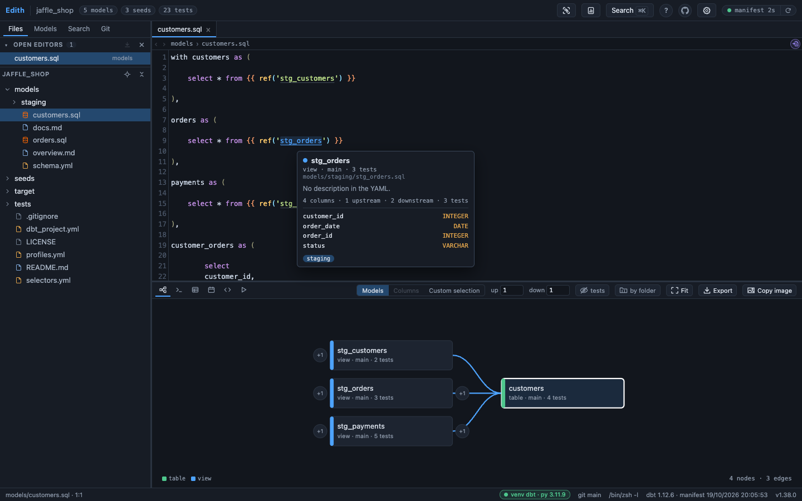
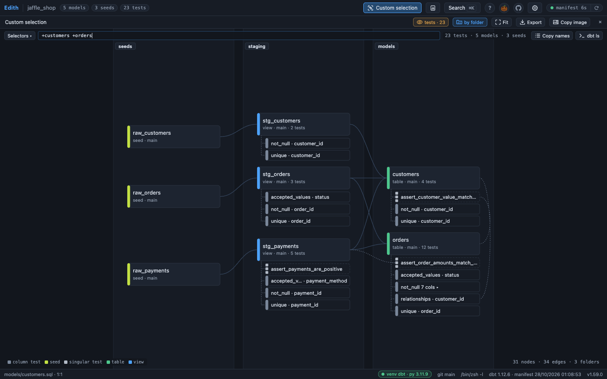
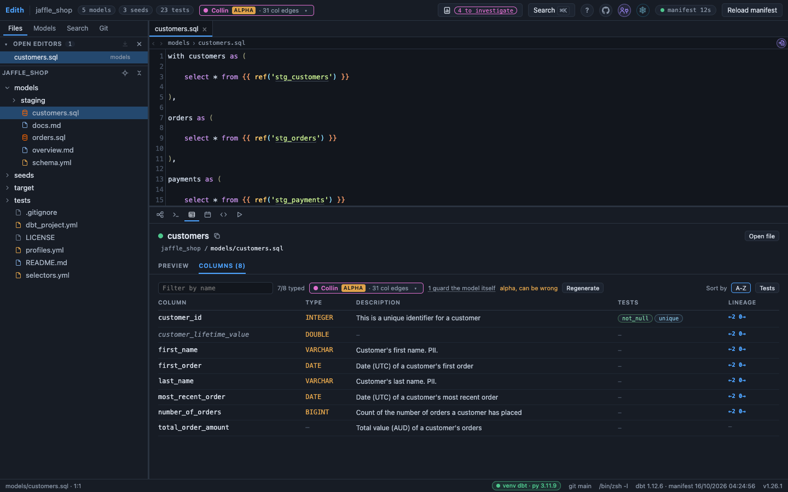
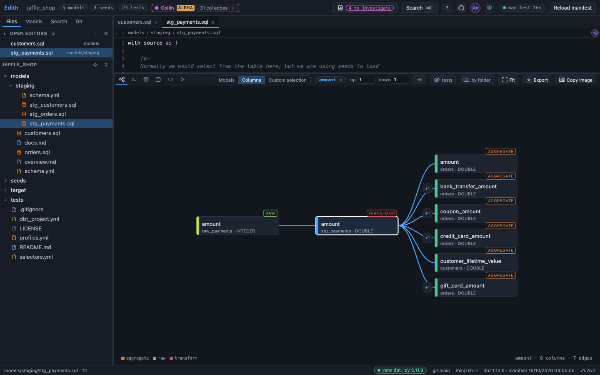
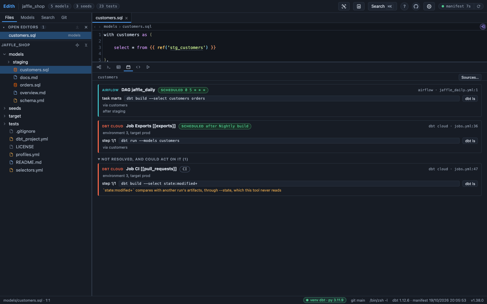
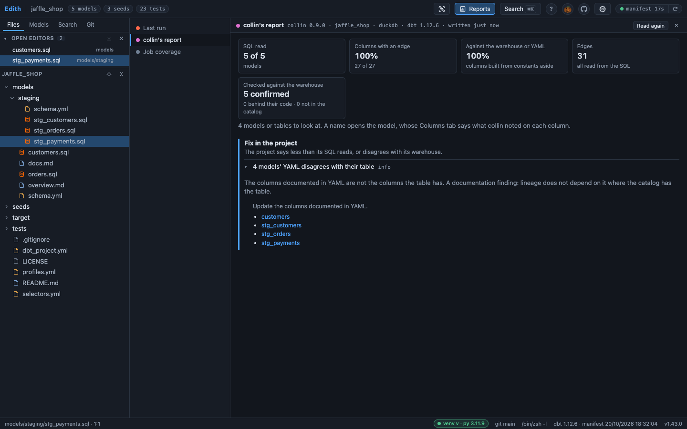

# dbt-edith

A small browser IDE for dbt projects: file tree, editor, terminal and lineage,
read straight from `target/manifest.json`.

It is one Rust binary with its UI inside it: no runtime, no Node, no installer,
nothing to set up on the machine that runs it. It was made for a locked-down
Windows machine, and runs the same on macOS and Linux. The lineage is already
in the manifest, so dbt-edith reads it once, keeps a compact graph in memory
and draws the part around the model you are on. It never runs dbt itself: dbt
runs in its terminal, when you run it.

```
cd /path/to/your-dbt-project
dbt-edith
```



## What it does

- **[Lineage](docs/features/lineage.md)** of the model you are editing, drawn
  from the manifest and following the editor, with a dot that says whether the
  manifest still matches your files.
- **[Custom selection](docs/features/selection.md)**: what any dbt selector or
  named selector matches, drawn on the canvas, and answered on the command line
  by `--select` without a server.
- **[Editor](docs/features/editor.md)** links: `ref()`, `source()`, macro calls
  and the folder keys of `dbt_project.yml` open what they name, and a hover
  card says what it is, the value of a `var()` or an `env_var()` included.
- **[Catalog](docs/features/catalog.md)**: a node's columns, tests and
  incremental strategy, where it is built in each of your `.env` environments,
  and the compiled and run SQL dbt left for it.
- **[Column lineage](docs/features/column-lineage.md)**, parsed from the
  compiled SQL by collin, or fetched from Snowflake on click, and answered on
  the command line by `--column`.
- **[Command line](docs/features/command-line.md)**: a node's card, the
  project's shape, a selection or a column, answered without a server, for
  scripts and agents, and over MCP for an agent that asks it (optional; with a
  terminal prefer the skill).
- **[Jobs and Reports](docs/features/jobs-and-reports.md)**: which Airflow DAG
  or dbt Cloud job runs a model, which models no scheduled job runs, and what
  the last dbt command did.
- **[Terminal and Git](docs/features/terminal-and-git.md)**: a real shell in
  your Python environment, and a Git tab that stages, commits, pulls, diffs and
  resolves conflicts, with no command that can destroy work.
- **[Snowflake](docs/features/snowflake.md)**, switched on per project: your
  query history, Snowsight links, and the statements that clone a model into
  your schema.

In the page, `?` lists every shortcut, and *Give me a tour* at the top of that
list walks through the page on one of your own models.



|  |  |
| --- | --- |
| The Catalog: each column's type, description, tests and lineage | One column's lineage, from the seed to the marts, read by collin |
|  |  |
| The Jobs tab: which DAG and which job run the model | collin's report: what it read, and what to fix |

Every picture is of dbt Labs' Jaffle Shop, with invented jobs.

## Getting started

### What you need

- **A dbt project parsed at least once.** dbt-edith reads
  `target/manifest.json`, which any `dbt parse` writes. A manifest from
  dbt-core 1.x and one from dbt Fusion 2 both load; Fusion is what it is used
  against day to day.
- **Rust, on the machine that builds**, from [rustup.rs](https://rustup.rs).
  The machine that runs it needs nothing.
- **git on `PATH`**, for the Git tab. On Windows,
  [Git for Windows](https://git-scm.com/download/win), or its PortableGit
  archive where nothing can be installed, also brings the Git Bash the
  terminal runs. Without git the rest still works.
- A browser.

### Install it

```
git clone https://github.com/IL-William/dbt-edith.git
cd dbt-edith
cargo install --path . --locked
```

That builds it and puts `dbt-edith` in `~/.cargo/bin`, which rustup already has
on your `PATH`. The repository is public, so the clone needs no account and no
key. There is no published download: building is how you get a binary.
`--locked` builds the crate versions `Cargo.lock` names, the ones CI audits;
without it, cargo picks the newest it may. `cargo build --release --locked`
leaves the same binary at `target/release/dbt-edith` if you would rather not
install it.

To update, `git pull` and run the same `cargo install` again. dbt-edith asks
GitHub, through git, whether a newer release is out, every hour from midnight
to 09:00 Paris time, and offers that command in the status bar when one is.
**Check for updates**, in the menu under Edith at the top left, asks at once
([docs/features/updates.md](docs/features/updates.md)).

### On Windows

Running the `.exe` needs no administrator rights and nothing installed. There
are two ways to get one, both in [docs/windows.md](docs/windows.md):

- cross-compile it on a Mac or Linux with `./scripts/build_windows.sh`, copy it
  over, and check that `certutil -hashfile dbt-edith.exe SHA256` gives the hash
  the script printed;
- or build it on the machine with `cargo install --path . --locked`, which needs
  a C toolchain there: Visual Studio Build Tools with administrator rights, or
  WinLibs from winget without.

### Run it

```
cd /path/to/your-dbt-project
dbt-edith
```

With no argument it opens the current directory, the one holding
`dbt_project.yml`; from anywhere else, pass that directory. It prints what it
found, then opens a browser:

```
  reading /home/you/analytics/target/manifest.json
  2104 nodes in 180 ms  (412 models, 96 sources, 1508 tests)

  dbt-edith  1.0.0  (v1.0.0, built 2026-10-10)
  project   /home/you/analytics
  shell     /bin/zsh -l
  venv      dbt-env (activated, python 3.12.4)
  open      http://127.0.0.1:4321/?key=3f9c…
            the key in it is this launch's: a tab opened without it can read nothing
```

Those lines say which manifest, shell and Python environment were picked up,
which is where most setup mistakes show first. The version carries the build it
came from, from `git describe` in the clone it was built in, so two installs
of one release are still told apart; the status bar shows it at the bottom
right of the page, and `dbt-edith --version` prints it without starting
anything.

Opening the link swaps its key for a cookie and takes it out of the address
bar, so bookmarks and new tabs work until the browser closes. Every launch
draws a new key: after a restart, open the new link
([0052](docs/decisions/0052-the-api-wants-the-key-this-launch-printed.md)).
`Ctrl+C` stops the server.

### If something looks off

| Symptom | Cause | Fix |
| --- | --- | --- |
| `dbt-edith: command not found` once `cargo install` finishes | `~/.cargo/bin` is not on your `PATH` | add that directory to your `PATH`, then open a new terminal |
| empty lineage, and startup said `no manifest at ...` | dbt has not written one, or it is elsewhere | run `dbt parse` in the project, or pass `--manifest path/to/manifest.json` |
| startup said `no dbt_project.yml in ...` | pointed at the wrong folder | pass the directory holding `dbt_project.yml` |
| the terminal opens PowerShell on Windows | Git Bash was not found where it is usually installed | point at it: `--shell '"C:\Program Files\Git\bin\bash.exe" -i'`, quotes included because of the space |
| the Git tab reports no repository | `git` is not on `PATH`, or the folder is not a clone | check `git -C <project> status` |
| column types are missing in the Catalog | no `catalog.json` | dbt Fusion: `dbt compile --write-catalog`; dbt-core: `dbt docs generate` |
| the URL says a port other than 4321 | 4321 was busy, so it walked forward to a free one | use the URL it printed, or pass `--port` |
| no browser opened | `--no-open`, or no default browser | open the printed URL by hand, key included |
| a red bar says `no key for this server in this tab` | the tab was not opened from the link this launch printed, or dbt-edith restarted since | open the link it printed; the browser keeps the key until it closes |
| a fix seems to have no effect after reinstalling | the running binary is an older build | compare `dbt-edith --version` with `git describe --tags --always --dirty` in the clone; on Windows, stop dbt-edith first, since the `.exe` cannot be replaced while it runs |

Anything about Snowflake is in [docs/features/snowflake.md](docs/features/snowflake.md).

## Options

```
dbt-edith [PROJECT]                       dbt project root, default the current directory
         [-p, --port 4321]               tries up to 20 ports from there, then gives up
         [--manifest path/manifest.json] default <project>/target/manifest.json
         [--catalog path/catalog.json]   default <project>/target/catalog.json, beside the manifest for --run-collin, --describe and --overview
         [--column-lineage path.json]    default the tool last picked, else the newest cache
         [--shell "zsh -l"]              the terminal's shell, default $SHELL -l, Git Bash on Windows
         [--no-open]                     do not open a browser at startup
         [--no-update-check]             never look on GitHub for a newer release, hourly or on demand
         [-s, --select "line"]           print what the line selects and exit, without serving
         [--exclude "line"]              what --select leaves out
         [--selector name]               print what a named selector selects and exit
         [--count-by KEY]                with --select or --selector, count by kind, materialized, source, folder, tag or package instead of listing
         [--column model.column]         print one column's lineage from the cache and exit
         [--up N|all] [--down N|all]     how far --column walks, default 0
         [--stop-at window,aggregate]    roles --column does not walk past downstream
         [--indirect]                    --column crosses collin's indirect edges too, left out by default
         [--column-tool collin]          whose cache --column reads, default collin's or Fusion's newest
         [--run-collin]                  run collin over the manifest first, and answer --column from its cache
         [--compiled DIR]                the compiled SQL --run-collin reads, default compiled/ beside the manifest
         [--describe name[,name...]]     print a node's card as the Catalog shows it and exit, without serving
         [--sql]                         --describe prints the node's own SQL file after its card
         [--overview]                    print what the project holds, by kind, materialization and folder, and exit
         [--depth N]                     how many folder levels --overview lists or --count-by folder counts, default 3
         [--output name|json|compact]    what those modes print, default one name per line
         [--mcp]                         answer an MCP client over stdio, through one tool taking these flags, and exit when it closes
         [-V, --version]                 print the version and the build it came from, and exit
```

A relative path in `--manifest`, `--catalog`, `--column-lineage` or
`--compiled` is relative to where you run the command, not to the project.
`dbt-edith --help` prints the same list.

## Changing dbt-edith

[AGENTS.md](AGENTS.md) says how to build and check a change, and the rules that
hold everywhere; `./scripts/check.sh` runs every test
([docs/testing.md](docs/testing.md)). [docs/decisions/](docs/decisions/) says
why it is built the way it is, [docs/state.md](docs/state.md) what is not built
yet and in what order, and [CHANGELOG.md](CHANGELOG.md) what shipped in which
version.

## Security

The server listens on `127.0.0.1` only and answers its own page alone: a
request whose `Host` or `Origin` names anything else is refused, and the API and
the terminal want the key the launch printed. Nothing outside the project is
read but the dbt profile and the job folders you name, and the profile's
passwords, tokens and keys never reach the browser.
[SECURITY.md](SECURITY.md) says what is and is not covered.

## License

Functional Source License 1.1 with an MIT future license (FSL-1.1-MIT), see
[LICENSE](LICENSE). Copyright 2026 Datadorelix.

Use it free of charge for anything except a competing use: making dbt-edith
available to others in a commercial product or service that substitutes for it
or offers substantially the same features. Using it inside a company, and in
professional services for a client, is allowed by name in the license. Two
years after a version is published, that version is also available under MIT.

Bundled third-party libraries keep their own licenses, listed in
[THIRD_PARTY_NOTICES.md](THIRD_PARTY_NOTICES.md).
