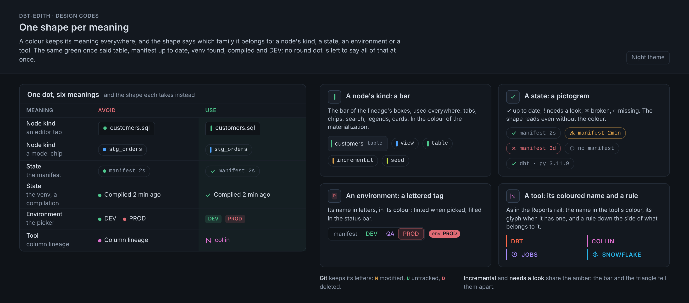
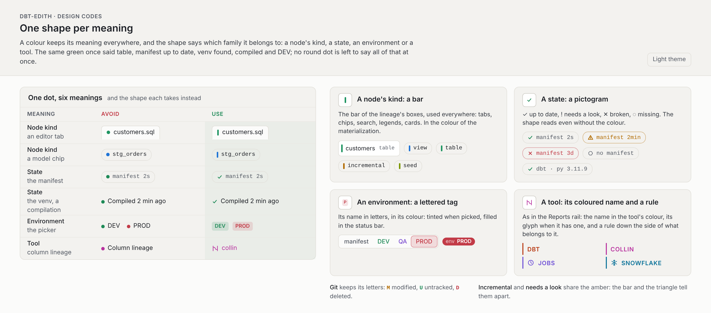
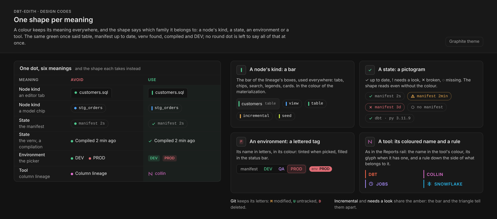
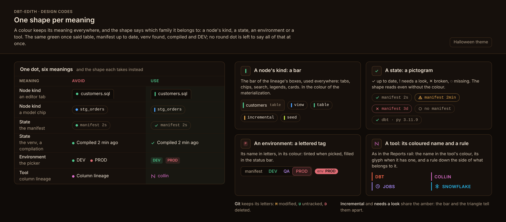
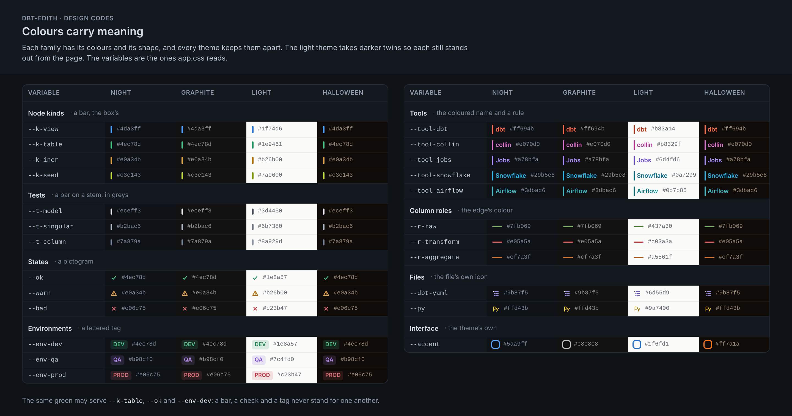
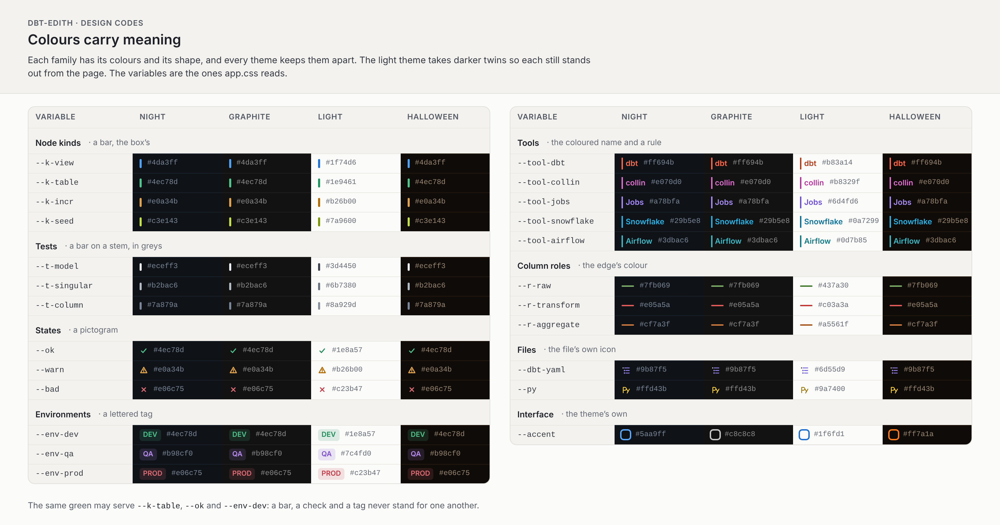
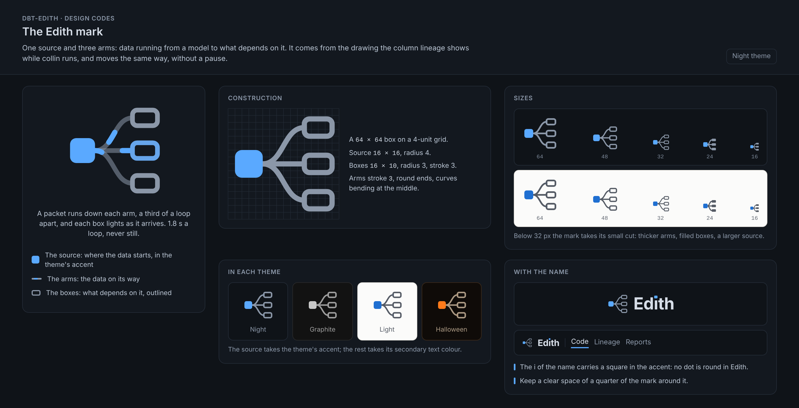
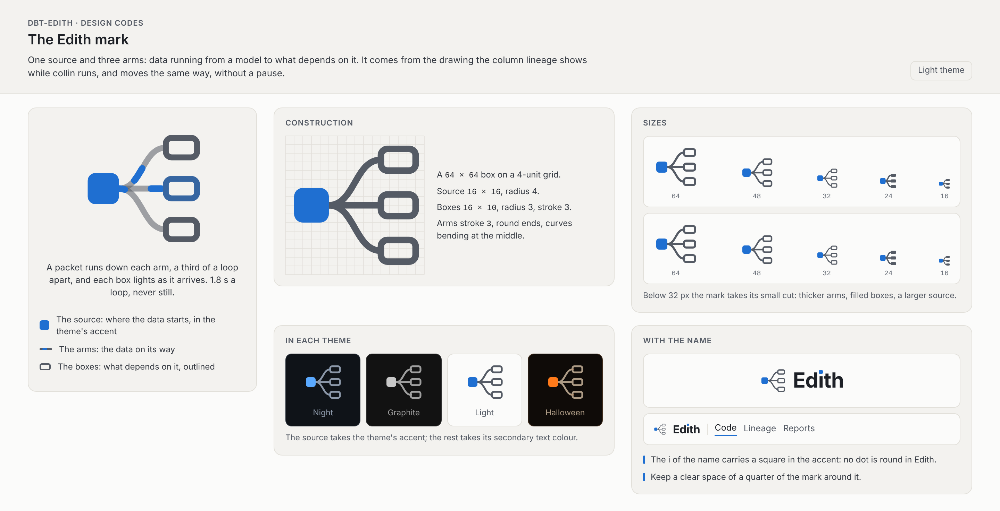

# The design's codes

These pictures are the codes of dbt-edith's design, drawn from the boards of
the redesign: one shape per meaning in each of the four themes, the colours
by meaning on a Night page and a Light page, and Edith's mark. The rules they
show, with the decisions and the tests that hold them, are in
[The design's rules](../features/look.md#the-designs-rules); what each screen
does is in [docs/features/](../features/).

They are kept as the boards drew them, so four things differ from the page:

- `--r-transform` is `#e86b6b` in Night, Graphite and Halloween, where the
  picture says `#e05a5a`.
- Light's `--t-column` is `#848c98`, where the picture says `#8a929d`.
- Light's `--k-table`, `--k-mview`, `--k-seed`, `--k-source`, `--k-snapshot`,
  `--k-exposure`, `--k-other` and `--k-custom` are a shade darker than the
  picture says, so that each holds 3:1 on a selected row's wash, and `--f-macro`
  is `#8b8a60`, where the picture says `#8f8e62`, for the palette's selected row.
- The mark's construction draws a large outlined mark; the page and the
  browser tab use only its small cut, drawn in `web/favicon.svg` and inlined as
  the brand in `web/index.html`.

## One shape per meaning

| Night | Light |
| --- | --- |
|  |  |

| Graphite | Halloween |
| --- | --- |
|  |  |

## Colours by meaning

| Night | Light |
| --- | --- |
|  |  |

## Edith's mark

| Night | Light |
| --- | --- |
|  |  |
