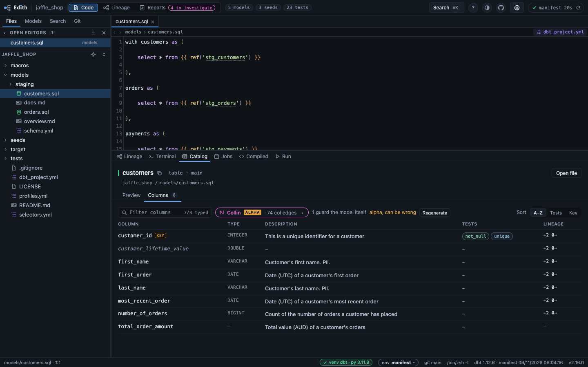
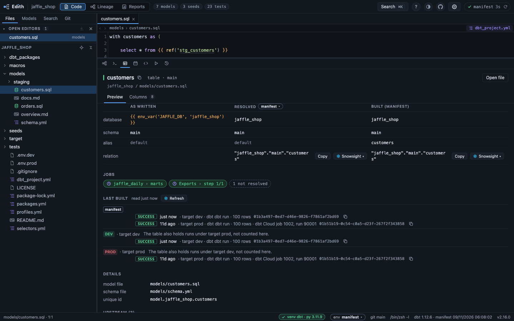
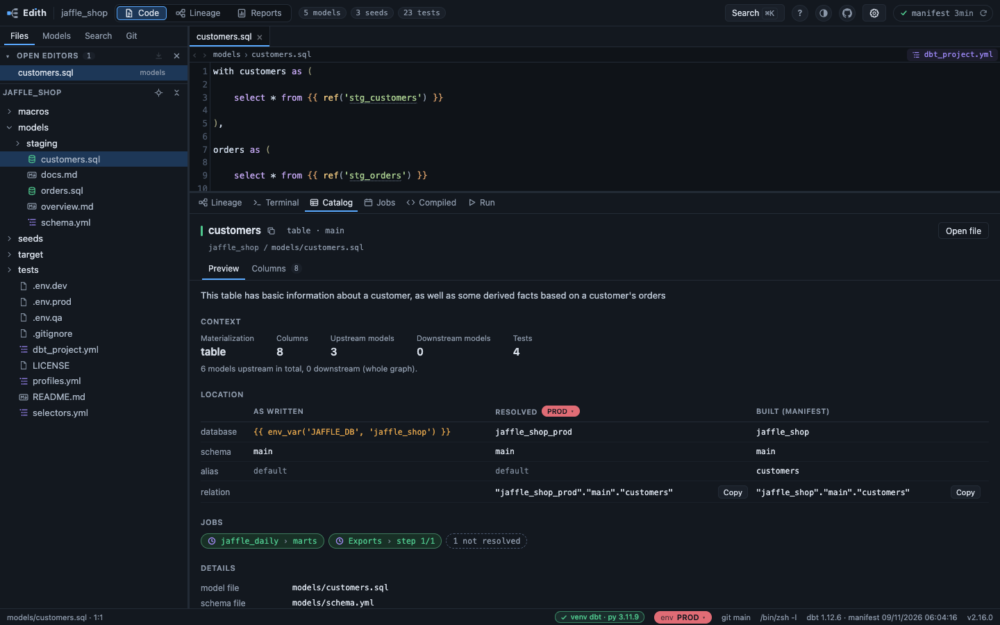
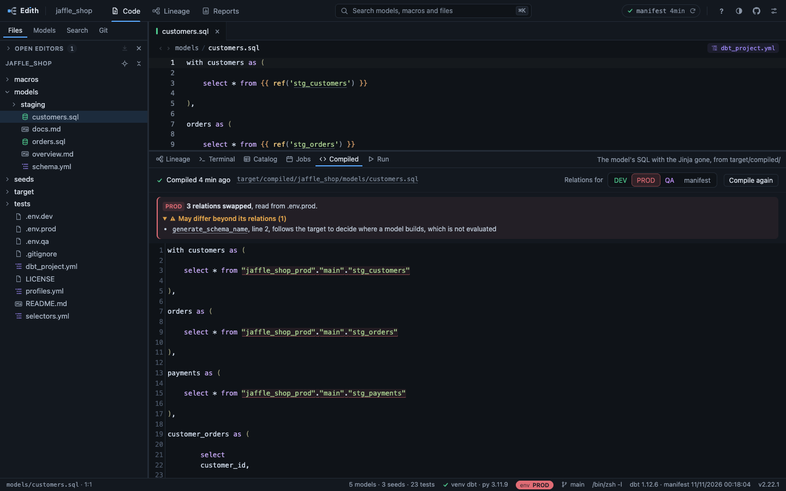

# Catalog

What the Catalog tab says about a node, where it is built in each environment,
and the Compiled and Run tabs over the SQL dbt left under `target/`.

## The Catalog tab



The **Catalog** tab mirrors what dbt's own catalog shows: materialization,
column count, upstream and downstream counts, tags and description under
Preview, and a Column / Type / Description / Tests table under Columns. The
upstream and downstream lists navigate like the graph: click moves the lineage
and the catalog to that node, double-click also opens its file. The column count
opens the Columns tab.
The head names the node with its materialization and schema beside it
(`table · main`, as the hover card says them), the package and the file under
it, and the two tabs as the dock's are drawn,
Columns with its count. Over the Columns table a field filters the columns by
name, the number of columns kept and of columns typed inside it at the right
(`3 of 8 · 7/8 typed`); Sort puts the columns A to Z or by their tests, and by
their key where a key names a column of the node, a seed or a source as well as
a model.
Each version of a versioned model is a node of its own, named as `dbt ls`
names it, `orders.v2`, which is also what the name's copy glyph copies: a
`--select` takes that one version. Beside the name, a chip says where it stands:
`latest`, the one a `ref()` naming no version reaches, or `old` or
`prerelease`, with the latest named.
An incremental model adds Strategy and Unique key beside the materialization,
the strategy as its box reads it, and a snapshot its Unique key. The key takes
one column per line, three at most, then `+N more, in Columns`, and each name
opens the Columns tab on its row. There, each key column carries a `KEY` tag,
and a Key sort puts them first, by key and then in the key's order.
A key is a list of columns that identify a row, declared by that `unique_key`,
by a `unique` test on one column or by a `dbt_utils.unique_combination_of_columns`
test, on any model, seed or source as well. Whatever declares it the tag says
`KEY`, and `KEY 1/2` for a column of a key of several, its place in the
`unique_key` or else in the test's list. Two declarations of one list, in any
order or case, are one key. A node with two different keys letters them, `KEY A`
and `KEY B 2/3`, the `unique_key` first, then the fewest columns. A tag is dashed
when a column of its key has no enabled `not_null` test, since dbt's `unique`
skips nulls and a merge on a null key inserts the row again; hovering it says
the columns, where the key is declared and which have no `not_null`. A test with
a `where`, or from another package than dbt's or dbt_utils, declares nothing,
and a `unique_key` written as an expression is counted, never checked for
`not_null`, and merged only with a `unique` test written on the same text
(0127). A view or a table that a
folder's config gave a strategy or a key lists it, dimmed, under details: it
does not use it, but `config.incremental_strategy:` still selects it.
Once a [job source](jobs-and-reports.md#jobs) is named, Preview also lists the steps that run the
node, one chip each, `DAG › task` or `job › step`, green when the job is
scheduled, amber when its schedule is not read and grey when it is not
scheduled, in the Jobs tab's order. A click on one
opens the Jobs tab on that node at that step, even when it is a box clicked
once in the lineage rather than the node in focus. A dashed chip counts the
steps not resolved, or the files not read, that could run it too.
A column's Tests cell names every test guarding it, one chip each: two
`relationships` on one column are two tests and read as two. Where they would
not fit, the first few are shown and a `+N` carries the rest, which hover, click
or Enter reveals with the name dbt generated for each. A click or Enter on a
chip opens its properties file at the line that declares the test. The tests
that guard the model rather than a column, which is every singular test under
`tests/` and every generic with no column such as
`unique_combination_of_columns`, are listed under Preview, where clicking one
moves the lineage to it and double-clicking opens it where it is declared.
A test shown in the Catalog has Preview alone, since it has no columns of its
own. It opens on what it checks, as its hover card says it: the generic, or
`singular`, the model whose YAML declares it, its column, its severity, `warn`
in amber, and the count of models it reads, which moves the lineage to them.
Under config come the keys it moved off dbt's defaults, among `store_failures`,
`store_failures_as`, `where`, `limit`, `fail_calc`, `warn_if` and `error_if`,
and, when it keeps its failing rows, the relation they are stored in: the only
one dbt builds for a test, which is why it has no location table. A
`--store-failures` given on the command line is not in the manifest, so it is
not shown. Then the steps that run it, its tags,
the file it is declared in, and the models it reads.
Everything there comes from `manifest.json`, which already holds the merged YAML
(descriptions, tags, and the tests attached to each column). Column *types* are
the exception: the manifest only carries them when they are declared in YAML, so
run `dbt compile --write-catalog` under Fusion, or `dbt docs generate` under
dbt-core, and
`catalog.json` is picked up automatically, filling in
the real warehouse types and listing the columns that exist in the warehouse but
are not documented (shown in italics).

## Where a model lives



The Catalog preview shows each node's database, schema and alias at three
stages, because in a project driven by `env_var()` and `generate_*_name`
macros no single value tells the whole story:

| | |
| --- | --- |
| **as written** | the config exactly as authored, Jinja included |
| **resolved** | the config with its env vars evaluated |
| **built** | where the target that produced the manifest actually built it |

A last row gives the full relation for *resolved* and *built*, each with a Copy
button, quoted part by part the way dbt quotes the built one. The resolved
relation is only offered when it can be written for real: a database or schema
left to the target profile, a placeholder or a missing variable says why
instead.

With Snowflake's features on, a **Snowsight** menu sits beside each Copy and
**Clone into my schema** beside the Location heading, both in
[snowflake.md](snowflake.md).

Without an environment selected, *resolved* is the config as dbt parsed it,
which means with whatever env vars happened to be loaded at the time. That is
not necessarily any particular environment: a shell that sourced a CI `.env`
file yields CI values.

When a manifest comes from a developer sandbox, where nearly every model is
built into one `database.schema`, dbt-edith detects it once and says so, rather
than flagging every model as moved. A model built somewhere unexpected is only
highlighted when it is the exception. The comparison is always between the
parsed config and the built location, which come from the same parse. Case
alone is never counted as a move, since Snowflake folds unquoted identifiers,
and neither is a pair of literal quotes that dbt drops.

## Last built

With Snowflake's features on and the dbt_artifacts package in the project, a
model's Catalog has a **Last built** section after its jobs: one block per
environment, the manifest's own first, with the last run's status (success, error
or another word as dbt wrote it), how long ago, the last success when the last
run was not that, the target, the dbt command, whether it was a full refresh,
rows affected, the invocation id with a Copy button and, for dbt Cloud, the job
and run ids. A failed run shows dbt's message under it; hover the time for the
clock time. An environment that could not be read is one warning line, with the
reason on hover; the line opens Reports' Builds by environment, where the
whole message is. A read that fails before any environment is asked, when the
package's models cannot be looked up, is one such line too, "the builds could
not be read", with the raw message on hover. An environment with no run says "no
run recorded in the last 90 days".

Nothing is asked until you press **Read from Snowflake** in the section's head,
which then says when it was read and offers **Refresh**. The same read feeds the
marks on the lineage and the Reports section, and is dropped when the page
closes ([snowflake.md](snowflake.md),
[0117](../decisions/0117-the-last-build-per-environment-is-read-from-dbt-artifacts.md)).

## Environments



The `env` pill in the status bar says which of the project's `.env` files the
*resolved* column is evaluated against, so a model's location can be read for
DEV, QA or UAT without running dbt. Built stays tied to the manifest's own
target. The file is picked in the pill's menu, the same menu in the header of
the resolved column, or in the Project section of the settings, which the
menu's Manage environments... opens, where *In the status bar* is a row of
buttons, one per file in the colour of its name and the manifest outlined, or from the row of buttons at the top of
the Compiled and Run tabs, which sets the same choice, so the status bar and the
Catalog follow it. With no file picked the choice is
`manifest`; on a manifest built into a developer sandbox it is named `my
compile`, with the sandbox beside it, since it is the developer's own compile.
The pill takes a colour per environment family (DEV, CI, QA, STG, UAT, PROD)
so the one in use shows at a glance. In the environment menu, the Catalog's
Last built and the Reports' builds, an environment is a tag in the same colour,
with the target it is kept to after it, and the manifest's own is only
outlined.

- **Detection.** Every `.env` and `.env.*` file in the project root is offered,
  named after its suffix: `.env.uat` is UAT. A `DBT_TARGET` that disagrees with
  the suffix is flagged, since it usually means a file copied from another
  environment. Templates (`.env.example`), backups, and files that define none
  of the variables in use start hidden.
- **Evaluation.** `{{ env_var('NAME') }}`, with or without a default, and plain
  literals are evaluated. A single `if` / `else` is followed through the branch
  dbt actually took when it parsed, and marked as such. Anything else, filters
  or `target.*` for instance, is shown as not evaluated rather than guessed.
- **The file alone.** Values come only from the chosen file, never from the
  shell dbt-edith was started in. So *missing* means "not defined in this file",
  which is not quite what dbt would see after sourcing several files in a row.
  `${...}` interpolation is kept as text and not evaluated.
- **Flagged, not shown as real.** Variables set to a placeholder (`N/A`, `TODO`,
  `null` and the like) or left undefined.
- **Secrets.** `DBT_ENV_SECRET_*` variables are never substituted, and no
  variable value is ever sent to the browser except resolved locations and
  `DBT_TARGET`.

The same section, which *Manage environments* in the menu opens, lists each
`.env` file with its environment, its `DBT_TARGET`, how many of the variables the
location config reads it defines, and how often it reproduces what dbt parsed,
and renames or hides files under *Names*. That last figure is, per file, how
often that file reproduces what dbt parsed: the file dbt actually had loaded
scores 100%, which makes it easy to spot which environment a manifest came from.

Those settings are stored per project in the user's config directory, never in
the project itself:

| | |
| --- | --- |
| macOS, Linux | `$XDG_CONFIG_HOME/dbt-edith`, else `~/.config/dbt-edith` |
| Windows | `%APPDATA%\dbt-edith` |
| anywhere | `DBT_EDITH_CONFIG_DIR` overrides both |

Each browser tab keeps its own environment. The stored one is only where a new
tab starts.

## Compiled and Run

Two tabs, over the two files dbt leaves per model under `target/`. **Compiled**
is `target/compiled/`: the model with its Jinja rendered, which is what you read
to check a macro or a `ref()` expanded the way you meant. **Run** is
`target/run/`: that same SQL wrapped in the statement dbt actually sent to the
warehouse, `create or replace transient table ...` and all, which is what you
read when the table is there but looks wrong.

Each names the date its file was written, with the age beside it:

```
last run 29/07/2026 16:48:06   54d ago, the model file changed after this was run
target/run/shop/models/marts/.../fct_orders.sql
```

That path is a link. Clicking it opens the file tree at the file, so the folder
dbt wrote, the files beside it and the file itself are one click away.

The bar turns amber when something the file was built from has moved since it
was written, and names what: the model, its schema file, `dbt_project.yml`, or a
macro. The Run tab asks one more question only it can ask, since dbt writes
`compiled/` on every compile and `run/` only on a run: has this model been
compiled again since it was last executed?

Age alone never colours anything. A file nothing has touched since is still
exactly what dbt would write, whether that was an hour ago or last month, and a
clock threshold only ever teaches you to ignore the colour. The date is there to
be read, not to expire.

Any macro counts, not just the ones your model calls. The manifest lists the
macros reached while parsing a node, which leaves out the ones those in turn
call and is mostly `macro.dbt.*`, built into dbt-core with no file to look at. A
macro edit makes every compiled file suspect until it is rebuilt, which is also
what dbt does about it. The same goes for a `git pull`: it moves the mtime of
everything it touches, so your artifacts predate the code you now have, which is
the answer [0025](../decisions/0025-freshness-is-mtimes-not-commits.md) gives
for the manifest too.

### For another environment



With an environment picked, both tabs show the same SQL as it
would read under that `.env` file, to paste into Snowsight without compiling
again. Each relation the SQL holds, the model's parents and, through an
ephemeral one, that one's parents, is replaced by the relation the Catalog's
Location table resolves for the file, and a Run statement's own table, with its
`__dbt_tmp` and `__dbt_backup` names, likewise. A swapped relation is tinted,
and its tooltip gives the name it had in the file dbt wrote. With none picked,
the tabs show the file as dbt wrote it (on a sandbox manifest, that choice is
named `my compile`, with the sandbox).

A row of buttons at the top of both tabs offers every environment, and the
manifest's own choice last, with or without one picked; a click sets the
choice the status bar's pill shows and the Catalog follows. With none picked, a
line under it says whose placement the SQL carries, such as `Shown as dbt
compiled it for the manifest's target`.

The picked button is filled in its environment's colour. A line under the
buttons names the environment, as plain words, and counts what it did: `Shown for
QA (.env.qa): 12 relations swapped, 1 kept as compiled`. A relation the file
cannot place stays as dbt compiled it, in amber, and its tooltip says why: a
variable the file does not define, a placeholder, a database or schema left to
the profile, or a model dbt built elsewhere than its config says, which means a
`generate_*_name` macro moved it and that is not evaluated. On a manifest built
into a developer sandbox, where every model sits away from its config, that
last case does not apply to a model built into the sandbox: it is written where
the file places it, and only a model built outside the sandbox, or whose alias
moved, is kept.

Under it, **May differ beyond its relations** lists what in the model, or in a
macro it reaches, however deep, reads the environment: a key of `target`, an
`env_var()`, a call that asks the warehouse (`run_query`, `adapter.get_*`...),
`is_incremental()`, and a project's own `generate_schema_name`,
`generate_database_name` or `generate_alias_name` that reads the target. Each
line names the macro and the line in it, and a macro opens at that line when
clicked; the list is a fold, open to start with, and counts what it holds. A
`generate_*_name` that reads the target only through a macro it calls says
`through` that macro and gives no line, and opens at its own first line. A line
in the model itself counts from the top of the file, blank lines included.
Nothing is evaluated: a branch on `target.name` is named, not followed. An environment variable that reads as a credential is not named.

dbt-edith never compiles or runs anything itself. dbt runs where you run it, so
when a file is not there the tab names the paths it checked and offers to type
`dbt compile --select <model>` or `dbt run --select <model>` into the integrated
terminal, without pressing Enter for you.
