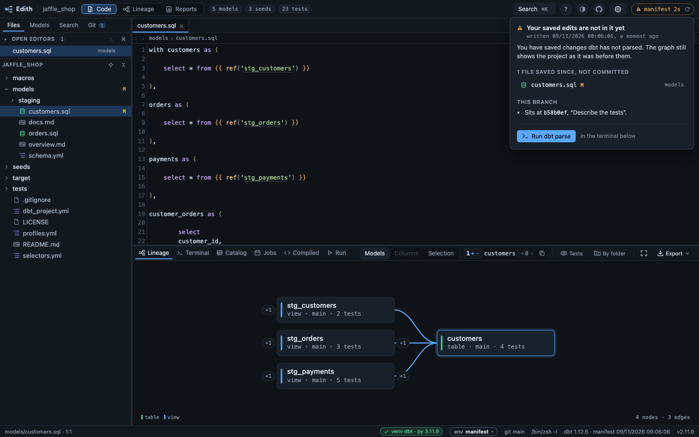
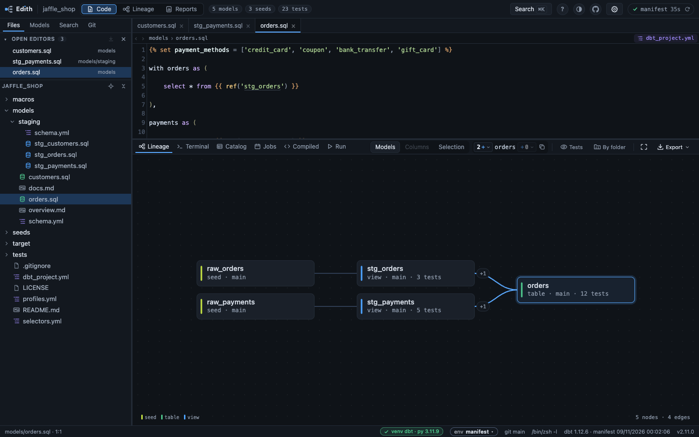
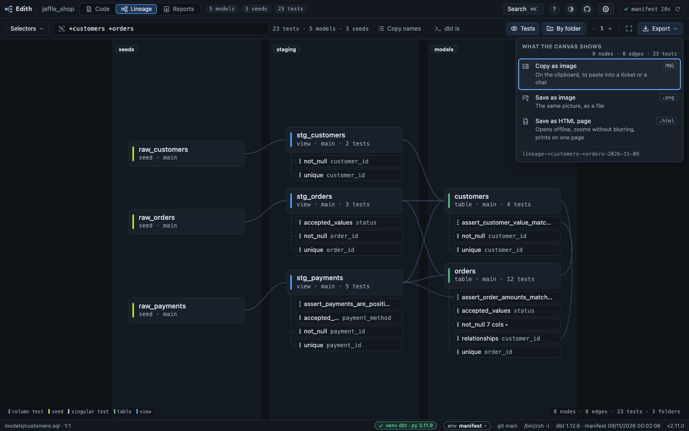

# Lineage

The graph of the node in focus: where it comes from, how it follows the editor,
whether it is still true, how to read it, and how to share it.

## Following the editor

Opening a `.sql` or `.yml` file that belongs to a dbt node moves the lineage
onto that node, so the graph follows the editor. A properties file declares
several: when the lineage already shows one of them, it stays there, and
otherwise it moves onto the first of them by name, the same one every time. A
file with no node yet, usually a model added or pulled since the last parse,
says so on the canvas, naming the model still drawn there if there is one, and
the lineage moves onto it by itself once `dbt parse` rewrites the manifest,
which dbt-edith reloads on its own within seconds. A macro file says nothing:
it has no node however fresh the manifest, and the lineage stays on the model
you were reading.

The depth is written the way dbt writes a selector, `1+ customers +0`, in the
dock's toolbar: a number each side of the focus's name, each one a button that
opens a menu of the levels that exist. A row gives the selector it draws
(`customers`, `1+customers`, `2+customers`) and what it adds (`alone`,
`+ 3 views`, `+ 2 views, 1 table`, `+ stg_customers` for a level of one node,
`· all` on the last level of the graph), the one drawn checked; the menu ends on
a line saying when the graph goes on past 20 levels, or when one side has
nothing (`Nothing downstream: customers has no children.`). A side with no level
shows 0 and its button says why when focused or hovered, though the depth behind
it still carries to the next model. The copy button writes the selector as it
shows, a zero side dropped (`Copied 2+customers+1`), with `source:` before a
source's name. A name past 24 characters is cut in the middle, whole in its
tooltip and in the copy; in a narrow dock it is the first thing to fold, giving
way to the bar of its kind before the tabs lose their labels. The menus open with Enter or Space, move
with the arrows and close on Escape. A Selection draws what its expression says,
so the depth is dimmed there.

The depth starts at 1 and 1 and keeps what you set while you walk the
canvas, double-clicking a box or pulling in a level with a `+N` badge. A model
reached any other way, from `Cmd/Ctrl + K`, a tab, a link in the editor or the
Catalog, brings both back to 1. Going back to a link you followed from another
tab, and forward again, brings back the depth the lineage had there.

The lineage graph itself comes entirely from `manifest.json` (`parent_map`).
No `.sql` file is ever parsed to build it: dbt already did that work.

`manifest.json` is polled every three seconds: run `dbt build` in the built-in
terminal and the lineage refreshes on its own when dbt rewrites the file.

## Is the lineage still true?

At the right of the top bar one outlined pill holds a mark, the word
`manifest`, its age and the drift from the default branch, and ends in circling
arrows that read `manifest.json` again at once, for the rare time the poll has
not. The outline turns amber or red with the mark. The mark answers one
question: does the manifest still match the files dbt would parse right now?

| | |
| --- | --- |
| green check | nothing dbt parses has changed since the manifest was written |
| amber triangle | files are newer, and all of them are yours, saved but not committed |
| red cross | files are newer and already committed: a checkout, a pull or a merge moved them under this manifest |
| grey dashed ring | there is no `manifest.json` yet |

Hovering or clicking the badge opens its card (a click holds it open, the focus
on its button; Escape or Tab closes it): when the manifest was written, the
files by group (a click opens one; git's letter shows
beside each file saved and not committed, and only that group has one), This
branch (where it sits, how far the default branch is ahead, when the refs were
last fetched), and **Run dbt parse**, which turns the mark
into a green check again. It runs in the terminal below, with Enter pressed for
you since `dbt parse` reaches no warehouse, except while the shell reads the
current folder, when it is only typed and Enter is left to you (0130). dbt runs
there, in your shell and your environment, never from the server. In a fresh
manifest the card has no button: it says there is nothing to do, or, when the
branch is behind the default one, to pull it and parse again.

Green does not mean recent. A manifest parsed three weeks ago on a branch
nobody has touched for three weeks is correct, and the age beside the mark is
there to say so. What makes a manifest wrong is a file moving under it, not
time passing.

A second segment appears when your branch has fallen behind the default one:
`main +7` means `origin/main` has seven commits you do not have. It never
changes the colour, because a branch behind `main` still has a manifest that is
true for the code in front of you; it is there so you know to pull before
trusting the lineage as a picture of production. That count is only as current
as your remote refs, so dbt-edith fetches every ten minutes in the background,
read only, and the card says when the refs were last refreshed.

## Reading the graph

Node colour is the materialization, not the resource type, because that is what
you reason about when reading a DAG: what exists in the warehouse and what gets
rebuilt. View, table, incremental and ephemeral each have their own colour,
sources, seeds and snapshots keep theirs, and **any materialization the tool
does not know is drawn in magenta** so a custom one stands out rather than
blending in. Ephemeral models are dashed, like disabled ones: nothing of them
exists in the warehouse. The legend in the corner lists only the
materializations actually on screen. A model's kind is the thin bar of its box,
and the same bar, in the same colour, stands before its name in the sidebar, the
palette, the Catalog and the cards, so a model looks the same everywhere.

**Click an entry of the legend** to keep what it names lit and fade the rest:
`incremental` leaves the incremental models and the edges between them. In
column mode the legend names what happened to each column instead, and
`transform` leaves the transform edges and the two columns each one joins;
`raw`, `generated` and `mixed` leave the columns wearing that badge, and
`indirect`, the dashed entry for collin's filter, join key and dedup key
edges, shown once the indirect button is on, leaves those edges and the
columns or model boxes they join, and `QUALIFY`, `JOIN` and `WHERE / HAVING`
leave the edges of one role. Click it again to see
everything. The pick stays while you move around the graph, as
long as the legend still lists it, and an exported graph is drawn without it.

In column mode, **stop at** beside the depth lists the roles the column
lineage holds, except the three indirect ones, each with how many of its edges
the canvas draws. A line under them counts the edges drawn with no role, and,
with the indirect button on, another the indirect edges, which no stop applies
to since each ends on a model's box, so the menu adds up to the edges the
status line counts. A role the canvas has none of is dimmed, and hovering a
role adds its count in the whole project. Tick `window` and each window edge
below the focused column is still drawn, with the column it reaches, so you
see how the column is used, but nothing past that column is, unless the walk
also reaches it some other way within the depth asked.
Several roles can be ticked. Upstream is left whole. A column the walk
stopped at wears the +N badge for what goes on, and the status line, copied
into an export, says where the walk stopped. The button names what it stops
at, and keeps it while you refocus on other columns, until the page is
reloaded.

An incremental model's box names its strategy in place of the word
`incremental`: `merge · marts · 3 tests`. One that configures none shows the
adapter's default, read from the macros the manifest carries, the project's
and its packages' overrides included, and keeps `incremental` when they do not
say. Where those macros insert every row for want of a unique key, the box
reads `append` with the strategy struck through: on Snowflake, a merge with no
key is a plain `insert into`. The hover card says where the strategy comes
from and why an append is one (0076).

Each box sits to the right of all its parents on screen, so every edge runs
left to right and a model always comes after what it reads. A model read by more
models than it reads moves right, to just before its first reader, which keeps
its edges short. An edge that skips columns runs level through a lane between
the boxes of each column it crosses rather than behind them, and a model read
across many columns shares one lane among its readers. In column mode, where the
lineage can loop, the one edge of each loop drawn against its direction is
dashed. The columns are an order, not a distance: the depth's numbers, the +N
badges and the export's `dbt ls` line still count levels from the focus, as dbt
does.

The **Tests** toggle beside the depth draws the data tests on the canvas
too. It is off to start with, and pressed it takes the neutral wash of a
selected row, the same as By folder, because tests can outnumber the models
several times over: hundreds of boxes slow the canvas and bury what it was
drawn for. Its tooltip says so and, while they are drawn, how many there are.

A test hangs under the model whose YAML declares it, as a one-line slip joined
to it by a stem. A singular test, which has no YAML, hangs under the last built
of the models it reads. An edge from another model the test reads comes in from
the left, loops out on the right when that model sits in the same column, and
comes back dashed when it is built later. The model's own stem, down its left
side with a tick into each row, is a thin dashed line; a line from another model
into a test is dotted and grey, where the lines between models are solid: either
links a check to what it checks rather than data to where it goes.

A model's box is 220 by 48 with its kind as a 3px bar set in from the left, the
name at 13px and the second line in mono at 11px; the lineage's focus has an
accent border on a tinted fill, and the box you click has a soft ring round it
too, which an export leaves out. A faint grid of dots lies behind the canvas. A
`+N` badge is a small pill, and a test is a 22px slip: the generic in the usual
type and its column after it in mono, dimmer.

A row says what the test checks rather than the name dbt generated for it. A
test alone on a column reads `unique · order_id`. Two or more tests of one
generic share a row, `not_null  12 cols ▸`, which a click or Enter opens into a
row per column, and closes again; a generic that guards the whole model several
times reads `expect_table_row_count_to_be_between ×3 ▸` and opens into its
tests, named by what is left of dbt's name once the generic and the model are
taken off. Generics on the whole model come first, then singular tests, then
generics on a column, each by name. A model whose rows all fit in five, every
group opened, starts with its groups open, so a model with three tests shows
three.

Each kind of test has a grey and a shape, lighter in the order the rows go, and
the legend names them: a generic on the whole model a near-white bar doubled by
a thin one, a singular test a light grey bar in three pieces and a dashed
outline, a generic on a column the grey bar every test had, each bar 3px wide
and 10 tall. A test at
`severity: warn` carries an amber triangle, and a group's row counts how many
of its tests do. The hover card on a test says which generic it is and on which
column, the package it was named through when dbt recorded one, and the
severity when it is warn.

One click on a test row opens its properties file as the preview tab, at the
item that declares the test, `- not_null` under its column or
`- dbt_utils.unique_combination_of_columns:` under the model, and moves there
too when that file is already the one shown; the keyboard stays on the canvas.
The test's lines, its arguments included, light up and fade, so the eye finds
it among the others.
A double click pins the tab. dbt records no line for a test, so the line is
read off the file: of two tests of one generic on one column, which differ
only by their arguments, the one named in the YAML as dbt names the test is
found, else the first. A singular test opens its own file at the top.

Past five rows, a model shows its first five and a chip, `+12 more tests`,
counting the tests in the rest; opened, it reads `▴ hide 12 tests` and folds
them again. The test the lineage is centred on is never folded away: in a
closed group it shows under the group's row on its own. The line under the
canvas counts what a chip hides, and the Tests tooltip, while pressed, counts
the tests sent. When the canvas is capped
for room, every model keeps some of its tests: the cap takes one test per model
a turn.

The **By folder** toggle, beside Tests, draws the same canvas by folder: each
folder gets a band of columns of its own, at the first level where the models
drawn stop sharing a path, so numbered layers such as `10_raw`, `20_clean` and
`30_vault` each read as a block. Their names stay pinned over the top of the
canvas while you pan, and pausing on a band's background names its folder in
full. The folders go left to right in the order of their numbers, then of the
edges between them, so `staging`, `intermediate` and `marts` need no numbers.
An edge that runs from a later folder back to an earlier one, a layer read by
one before it, is dashed, and the line under the canvas counts them. Seeds,
snapshots and each installed package get a band of their own, and a test sits
with the model it tests. It costs width, since a band starts only where the one
before it ends: a way of reading the graph, not a better layout of it
([0029](../decisions/0029-the-canvas-may-be-drawn-by-folder.md)). An exported
file and a copied image keep the bands, with each name written at the top.

While the toggle is on, a **levels** control sits beside it, a minus, the number
and a plus, which a click or the keyboard steps from 1 to 4, in the dock and in
the Lineage space alike, so nothing opens over the canvas. It cuts
each band by its sub-folders: at 2, a `marts` holding `core` and `finance`
draws each of them as a rectangle inside its band, in the hue of its level, with
their names on a second row; 3 and 4 go one and two levels further. Sub-folders
keep the order folders have, numbers first and then edges, inside their band,
which never moves for them. The models filed in a folder beside its
sub-folders get columns of their own there, with no rectangle round them. A
level is the same depth on every band, so a folder holding a single sub-folder
still draws it, and each level costs columns
([0080](../decisions/0080-a-band-may-be-cut-by-its-sub-folders.md)).

### Last built, as a mark

Once the Catalog's Last built (or Reports' Builds by environment) has been read,
each model box carries a small mark in its top right corner for the environment
the `env` pill names, the manifest's own build when none is picked: a green
check when its last success is within the threshold, an amber triangle when it
is older, a red cross when its last attempt failed, and a dashed ring when no
run is recorded. Pausing on the
mark says the environment, the status and how long ago, the target, and the last
success. When the table holds runs of several targets, the mark takes the worst
of them, error before stale before not built before ok, and says each. Picking another environment repaints the marks without drawing the graph
again; an environment that was not read, or whose read failed, paints none, and
neither do ephemeral or disabled models, tests or the column mode. An export and
a copied image never carry the marks: a live read of other environments is not
kept, and a file is
([0117](../decisions/0117-the-last-build-per-environment-is-read-from-dbt-artifacts.md)).

## Sharing the graph

At the right of the bar above the canvas, after a thin line, two buttons: **Fit**,
four corners and nothing else, named by its tooltip, brings the whole graph into
the pane; **Export**, a file coming down into a tray with a chevron, opens a
menu of the three ways out.

Its head says what the canvas shows and how much, folded tests included,
`4 nodes · 3 edges · 11 tests` (a test is no node and its stem no edge), or
`8 columns` on a column canvas, the model boxes not counted. It can differ from
the line under the canvas, which also counts what a selection keeps for context
or a cap leaves out, and says how many of the tests are folded under a chip
(`11 tests · 3 folded`). Its rows,
each with a format tag and a sentence, are **Copy as image** (PNG), which puts
the picture on the clipboard to paste into a ticket or a chat; **Save as image**
(.png), the same picture as a file; and **Save as HTML page** (.html). Its foot
is the name the file takes, `lineage-<what it shows>-<date>`, without its
extension, the date being the exporter's own day. With nothing drawn the head
says so and the rows cannot be picked. Each output says what it did in a toast:
`Saved <name>`, `Image copied: paste it into the ticket`, or `The clipboard took
no image, saved <name> instead`. Enter or Space on the button opens the menu on
its first row, the arrows step through the rows, Enter picks one and Escape
closes the menu and gives the button its focus back. Copy names, under a list
glyph, is in the bar of the [Lineage space](selection.md) and copies the names,
never the picture. On a narrow window the depth control's name gives way to the bar of its kind
first, then the dock's tabs show their glyphs alone; on a narrower one still,
when the row runs out of room even then, Export keeps its glyph and chevron
alone too, named by its tooltip.

**Save as HTML page** saves what the canvas shows as one HTML file named after it,
`lineage-<what it shows>-<date>.html`, for a ticket or a message.
Anyone opens it in a browser with nothing installed and no network. The wheel
zooms without blurring, at least as close as the canvas does, however tall the
graph; a drag pans, `0` fits it back, and a click on a box lights its edges.
**Nodes** lists every box with its full name and file, and a
name too long for its box is written whole in the box too, smaller, rather than
cut short as it is on screen.

The header says what the picture is. It names the `dbt ls` command that lists
the same nodes, with `--exclude "resource_type:test"` when no test is drawn,
since dbt would list them. It repeats the warnings of a mistyped selector, and
says how much of a capped selection was drawn, the rest being listed by name.
It says where the picture came from, the project, the dbt version, the
manifest's date, the branch and commit, and whether the manifest still matched
the files at that moment. Every date carries its offset from UTC: the reader may
be elsewhere, and reads it later.

**Ctrl+P** then *Save as PDF* in that file prints the whole graph on one page,
as vectors, so the PDF zooms too. **Copy as image** puts the same picture on the
clipboard as a PNG to paste into a ticket's description, and saves the PNG when
the browser refuses the clipboard; **Save as image** saves it without trying
the clipboard. In a ticket, the PDF and the pasted image show in place; the
HTML file is downloaded and opened, and it is the one that pans and lists
names. Both are drawn in the theme on screen, and in Night under
Halloween, whose drawings never leave the page
([0150](../decisions/0150-a-theme-is-a-set-of-variables-on-the-page-and-halloween-is-one.md)).

The file holds what the canvas shows and that header, nothing else: no absolute
path and no value from a `.env` file
([0026](../decisions/0026-the-lineage-exports-as-one-html-file.md)).
