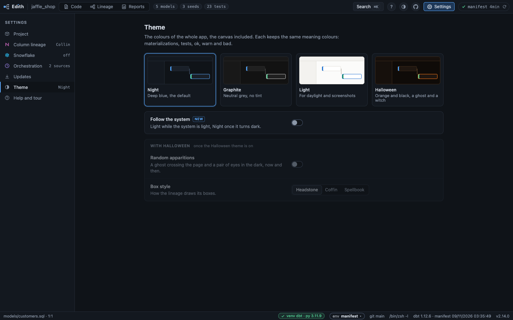

# Themes

The page has four sets of colours, Night, Graphite, Light and Halloween, picked
from the top bar or the settings. A theme changes the colours of the whole
page, the lineage canvas and the editor included, and nothing about what
dbt-edith reads or shows. The colours that carry a meaning, the kinds of node,
the tests, the environments, a warning, a success or a failure, keep theirs in
every theme, in a darker twin where the page is light (0150, 0106, 0107, 0108).

## Picking one

The half-filled circle in the top bar, between the shortcut list's `?` and
GitHub, opens a menu of the four, each with a small swatch painted in its own
colours; the one on screen is checked. The arrows move over them, Enter picks,
Escape closes the menu and gives the focus back to the button.

The settings have a Theme section with the same four as cards, each with a
preview, and under them **Follow the system**, a row with its switch at the
right: while it is on the page shows Light while the system is light and Night
once it turns dark, and follows the system as it changes. Picking a theme, from
the menu or a card, turns Follow off and keeps that pick; turning Follow off
keeps the theme on screen. The arrows move over the cards and pick as they go.
What belongs to Halloween sits in a card of its own under them, dimmed while
another theme is on with its controls still usable: a switch for the random
apparitions and the box style, **Headstone**, **Coffin** or **Spellbook**, a row
of three buttons the arrows move over and pick as they go
([0163](../decisions/0163-the-settings-are-one-column-of-rows.md)).

What you pick is kept on the machine, in `look.json` in dbt-edith's config
directory, so it holds for every project and every start; where there is no
config directory it lasts until the page is closed. The page starts in Night and
changes once the server has answered, and another open page keeps its theme
until it is reloaded.

## The four

- **Night**: deep blue, the default.
- **Graphite**: neutral grey with no tint, and colour only where it means
  something.
- **Light**: for daylight and screenshots. Each colour that means something is
  darker than in Night, at least 3:1 on the page and on the sidebar's grey,
  and the code colours at least 4.5:1 on the page.
- **Halloween**: orange and black, with a ghost and a witch, below.

The terminal keeps its dark colours in every theme for now: a light one wants
sixteen colours of its own.

## Exports

The Export menu above the graph (Copy as image, Save as image, Save as HTML
page) draws the lineage in the theme on screen, so a file sent to a colleague
or a picture pasted in a ticket is as light as the page was. Under Halloween
each takes Night: the drawings below stay on the page, and a file with the
browns and none of the art would be neither theme.

## The Halloween theme

Orange and black, with drawings that move, for anyone who wants it. It changes
nothing about what dbt-edith reads or shows. The Theme section's **With
Halloween** group, dimmed while another theme is on and still usable, holds the
random apparitions and the box style.

- **Colours**: the page turns near-black with brown lines and the accent
  orange.
- **A ghost on Edith's E**, top left. It glows when a newer release is out, and
  at night, between 20:00 and 07:00 by your own clock.
- **A witch on her broom** flies over the dock's tabs to the one you open.
- **Zombie switches**: each switch in the settings becomes a zombie that walks
  to the other side when you flip it, facing the way it goes.
- **The lineage's boxes**, in the style the Box style picks, the headstone
  unless you pick another. Picking one redraws nothing:
  - **Headstone**: a grey stone slab with an arched top, a chiselled edge, an
    engraved cross and a crack, the kind as moss along its base. Under the
    pointer the stone shudders, as if something pushed from underneath.
  - **Coffin**: dark wood with chamfered ends and a lid line, studded with
    pins, a gold cross at its head with the kind as its gem. Under the pointer
    it shakes and its lid lifts a little.
  - **Spellbook**: purple leather in a double gold border, a banded spine at
    the left with the kind as its gem, pages at the right. Under the pointer
    its cover lifts from the spine.

  The names are serif, and a long one ends in an ellipsis a little sooner than
  in the other themes; its hover card has the whole name. A box that is the
  focus, selected, a find match or drawn dashed (an ephemeral model) takes its
  ring on the silhouette itself. The tests under a model keep their usual
  shape, and the ring round the box you click is not drawn: its states have
  colours of their own. A column's role tag, inside its box, has a dark fill here, and the coffin
  and the spellbook move it in from their ends. Edges become thin silk, the edges of the box you select turn orange (a column edge keeps its role's hue, its dewdrops orange),
  and a cobweb hangs in two corners of the canvas. The dashes that say an edge
  is a test, a back edge or indirect are kept, and those edges have no
  dewdrops.

  Where the boxes have their drawings, the silk carries small dewdrops, lighter
  in the hue of a role and orange on the edges of the box you selected. When
  you click a box, a small web grows on its top right corner, beside the box
  and not over it: threads, then arcs, then a spider that drops on its thread,
  in less than a second, again at each new selection. It is there with any style
  and on any size of canvas, and with reduced motion it simply appears (0108).

  The drawings come with up to 400 boxes on the canvas. A bigger selection
  gets a plainer version of the same style: the colour and the silhouette,
  without the cross, the plate, the spine or the rings following the shape
  (a ring is then a rounded rectangle), and the silk has no dewdrops. There
  the corners a silhouette cuts away take no click, which falls through to the
  canvas (0107).
- **Apparitions**: now and then a ghost crosses the page, every few minutes at
  random, and a pair of eyes blinks somewhere on the page a little less often.
  Neither takes a click, and none shows while the tab is hidden. The Random
  apparitions switch turns them off, and any on screen goes at once. They make
  no sound.

With reduced motion asked of the system, no box moves under the pointer, no
ghost crosses, the witch jumps rather than flies and the eyes fade without
blinking.
