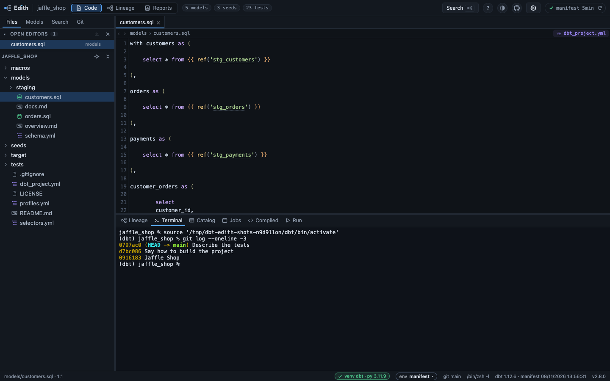
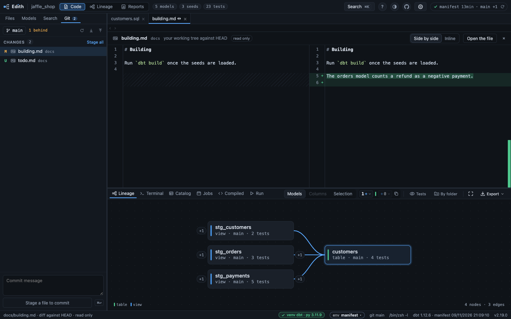

# Terminal and Git

The shell in the dock, the Python environment it runs in, and the Git tab.

## Terminal

The terminal runs `$SHELL -l` on macOS
and Linux, and Git Bash on Windows, falling back to PowerShell when Git Bash is
not installed. It starts with the environment dbt-edith was started in: activate
the project's virtual environment first, and `dbt` in the terminal is that
environment's. Each new terminal then types that environment's own activate
script, `source …/activate` for bash and zsh, so it comes first again after
your `~/.bashrc` or `~/.zshrc`, which may have put pyenv or conda before it.

Some shells read the current folder when they look for a program, so a `git`,
`dbt` or `cargo` in the project would run in place of the one meant. A relative
entry of the `PATH` (`.`, `bin`) is read from the current folder by bash, zsh
and the other POSIX shells everywhere, Git Bash included; PowerShell does it for
an entry that starts with a dot. An empty one (a leading or trailing separator,
a doubled one) is read as the current folder by those shells on Linux and in a
macOS shell that is not a login one; the default `$SHELL -l` on a Mac and Git
Bash drop it before the first prompt, and PowerShell drops it too, so nothing is
said there. cmd.exe looks in the current folder first whatever the `PATH` holds.
When the shell does, the startup banner says so on a `warning` line, naming the
relative entry as written, Edith's menu says the same in a sentence, and the
manifest card's button types `dbt parse` and leaves Enter to you instead of pressing
it, so you see the line before it runs. For the `PATH` reasons the check reads
the `PATH` dbt-edith hands the shell, which the shell's startup files may still
change
([0130](../decisions/0130-a-path-that-reads-the-current-folder-is-warned-of-not-typed-around.md),
[0071](../decisions/0071-a-click-types-a-dbt-command-and-leaves-enter-to-you.md)).

The terminal wears the theme: its page is the page's colour, its text, cursor
and selection the theme's, and its sixteen ANSI colours are each theme's own, so
Light has a light terminal and Halloween a brown one. Picking another theme
repaints it at once. The text is 12.5px on rows of about 19px
([0161](../decisions/0161-the-terminal-takes-the-themes-colours-and-marks-what-is-typed-for-you.md)).

While the Terminal tab is open, the dock's row beside the tabs holds its tools:
a chip with the venv the terminal runs dbt with, in the words the prompt uses
(`(dbt) py 3.11.9` when active, `(dbt) inactive` when found and not active,
`no venv` otherwise) and the same check, triangle or dashed ring as the status
bar's pill; the shell and the project it starts in (`zsh · jaffle_shop`); and
two buttons. Clear empties the screen and keeps the shell. Restart the shell
closes the connection, which ends the shell, and starts a new one in the
project's folder, with no "disconnected" line. Both give the focus back to the
terminal.

A button that types a command into the terminal, the manifest card's, a job
step's `dbt ls`, the selection's, the Compiled and Run tabs', the settings'
activation lines and the update's, marks it at the end of its line with a chip:
`typed from the Jobs tab · Enter is yours`, or `run from the manifest's card`
for the one command whose Enter the page presses. The chip goes when you type
a key or paste, when bash shows its next prompt, on Clear and on Restart, and
there is only one. If the shell does not echo the line within a second, the toast
`command ready in the terminal, press Enter to run it` says it instead.

## Python environment

The status bar shows the virtualenv, labelled `venv` when it was active as
dbt-edith started and `venv (inactive)` when it was merely found in the project,
with the Python and dbt versions in the tooltip. When several are present, the
one that actually contains dbt wins.

With bash in the terminal, Git Bash included, the bar then follows the
terminal: `source .../activate` or a project's own activation script, and the
bar names that venv at the next prompt; `deactivate`, and it says `venv
(inactive)` again. A venv made in the project since dbt-edith started is read
when the terminal names it. Any other venv, outside the project or tracked by
git, is named without its versions, unless dbt-edith was started in it. zsh,
fish and PowerShell do not say which venv they hold, and there the bar stays as
dbt-edith started
([0069](../decisions/0069-the-status-bar-names-the-venv-the-terminal-reports.md)).

The pill is green with a check when the venv is active, and amber with a
triangle when it is not; with none it is a dashed ring. A click
opens the Project section of the settings, where its Python group says the same
as the tooltip: the venv's path, its Python and dbt versions as chips, and a
line with the state's pictogram (a check, a triangle or a dashed ring) and the
sentence that says it, the rest of the tooltip under them; while it is amber,
each venv of the project has a button there that
types the line that activates it in the terminal, `source .../activate` for
bash, waiting for Enter
([0072](../decisions/0072-a-click-on-an-inactive-venv-types-its-activate-line.md),
[0100](../decisions/0100-the-settings-open-in-a-panel-of-their-own.md)).

Those versions are read from the venv's files, `pyvenv.cfg` and the names of
its installed packages: opening a project runs nothing it holds. A venv that git
tracks came with the repository, and its `python` was written by whoever wrote
the repository, so dbt-edith never runs it, neither for the status bar nor for
the Snowflake script; the tooltip names it
([0053](../decisions/0053-a-project-is-read-before-anything-in-it-runs.md)).

## Git

A third sidebar tab stages, commits, pulls and pushes. Its first row holds the
branch (a button that opens a filtered branch switcher rather than a list, since a
long-lived repository easily carries hundreds of branches, as does the branch name
in the status bar), then how far the branch is from its upstream in words, `1
behind` in amber, `2 ahead` in grey, or both, nothing when level or with no
upstream, and the hover names the upstream. Fetch, pull and push are three
glyphs whose titles say what each would do: `Pull 1 commit (fast-forward
only)`, `Push 2 commits`, `Nothing to push` (push stays pressable, and its
dialog says why).

Under it the changes are in sections, `Conflicts`, `Staged` and `Changes`, each
with a count and a `Stage all` or `Unstage all` link. A file is a row of its
letter (modified in amber, new in green, deleted in red, a conflicted file's
in red), its icon, its whole name, and its
folder in dim type after it: the name is cut only when the row is too narrow
for it. `+` stages, `−` unstages and a tick marks a conflicted file resolved,
each shown when the pointer is on the row or the keyboard is in it. A row is a
stop of the keyboard: Enter or Space opens its diff, and the row of the diff in
front is marked.

At the foot, the message box and a button that says what it would commit:
`Commit 2 files`, `Commit the merge` when a merge has nothing left conflicted,
`Resolve the conflicts first`, or `Stage a file to commit`, outlined, which says
why when pressed. The shortcut, `Cmd+Enter` or `Ctrl+Enter` in the box, is drawn
beside it.

Three rules hold across the whole git surface:

- **Nothing destroys work.** There is no `-f`, no `--hard`, no `clean`, no
  `push --force` anywhere in `src/git.rs`. The worst any button can do is create
  a stash. When a branch switch is refused because local changes are in the way,
  the blocking paths are listed and the only offer is to stash them, tagged with
  the branch being left, recoverable with `git stash pop`.
- **Nothing can hang the server.** Network commands run with
  `GIT_TERMINAL_PROMPT=0` and ssh in batch mode, so a missing credential fails
  in seconds instead of waiting forever on a prompt nobody can answer. Every
  command has a deadline, and both pipes are drained by their own threads so a
  chatty hook cannot deadlock.
- **A repository's own configuration never names a program git runs.** A
  project copied with its `.git` brings its `config` and its hooks, and the
  status is polled every five seconds. Every call switches the file-system
  monitor off, and what runs on a timer, the status, the freshness badge's
  questions and its fetch, also switches hooks off. Before any call, the keys
  of the repository's own `config` and `config.worktree` are read, which runs
  nothing, and held to a list of data-only ones: remotes, branches, identity,
  signing format, submodule addresses and the like. One outside it, a
  `credential.helper`, a `filter.*`, a `core.pager`, a
  `remote.*.uploadpack`, a proxy or an `include`, pauses git in that
  repository (as does a configuration git cannot list at all, naming git's
  reason): the
  Git panel and the freshness card say that git is paused because the
  repository's own configuration names a program, and name the key, and no git
  is run until it is gone. git in the terminal is unaffected. The timed fetch,
  and a checkout, speak https, http and ssh only, so a remote on a local path,
  a `git://` one or one behind a remote helper (a `codecommit::` URL) is not
  refreshed by the timer. The gate needs git 2.26 or later (an older git is
  paused in every repository as unreadable, and asked again at each poll), and
  the refusal to take a bare-looking folder for a repository needs 2.38 or
  later
  ([0121](../decisions/0121-git-runs-nothing-a-repositorys-own-config-names.md)).

Commit fetches first, so the ahead/behind counts next to it are current; a
failing fetch never blocks the commit. Hooks always run: pre-commit hooks can take
a while and can fail, and their output is shown in full rather than bypassed
with `--no-verify`. Pull is `--ff-only`, so it can
never start a merge on its own; if the branches have diverged it says so and
leaves the choice of merge or rebase to you.

Clicking a changed file opens its diff against HEAD, in its own tab, read-only.
Its head is one row: the file's icon, its name, its folder, what is compared
(`your working tree against HEAD`, `a new file, nothing in HEAD`, `deleted from
your working tree`, with ` · line endings differ (CRLF here, LF in HEAD)` added
when the two sides end their lines differently, since the lines are compared
without their CRs and such a file may have no changed line), a `read only` chip, the layout switch and `Open the file`,
which edits it. Two layouts, picked with the switch (the arrow keys move it):

- **Side by side**, HEAD on the left and the working tree on the right, the
  panes meeting at a one pixel rule. Regions with no counterpart on the other
  side are hatched. A `+` or `−` sits next to every changed line, the line is
  tinted green or red in the rows and in the number gutters, and the words that
  changed inside it are tinted stronger.
- **Inline**, one list holding the lines of both sides in order, with a number
  for HEAD and one for the working tree, the same tints, and the lines that
  changed marked as lines (not as words).

Both wrap their lines instead of cutting them, so a long line is read whole;
the 12 lines beside a change stay in view, and a stretch of more than 12
unchanged lines beyond them folds into a row that says `16 unchanged lines`,
which a click opens; and a ruler down the right edge shows
where the changes are and jumps to them. New files show entirely as added,
deleted ones as removed. The choice of layout holds for every diff tab until the
page is closed, and switching keeps the first line in view. A Markdown file reads
the same in its diff as in its own tab: a heading is bold text with quiet `#`
marks, inline code is in the string colour.
Editing stays in the file itself, one button away.

Conflicted files get their own section. Opening one highlights the
`<<<<<<<` / `=======` / `>>>>>>>` blocks and puts *keep ours / keep theirs /
keep both* above each one; a block only counts once all three markers are
present, so a half-edited file is left alone. When a file is done, one button
marks it resolved (`git add`), and the merge can be aborted at any point.
